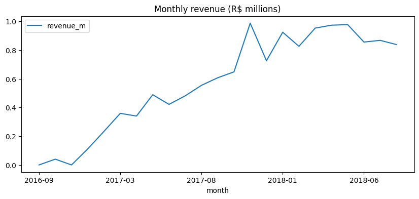
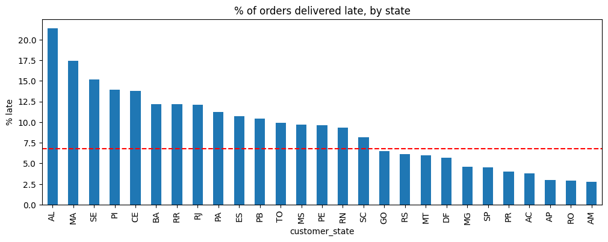
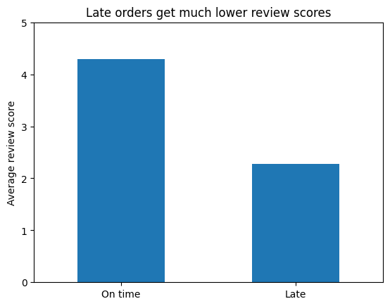

# Brazilian E-Commerce Company (Olist): Deliveries, Reviews and Repeat Customers

An analysis of Olist, a company that connects small and medium Brazilian stores to large online marketplaces. We try to understand the growth of the business and where deliveries fell short. Built with Python, Pandas and Google Colab.

🇧🇷 Resumo: análise de ~100 mil pedidos da Olist em Python (Pandas). Principais resultados: 6,8% das entregas atrasaram (21% em AL), pedidos atrasados têm nota média 2,3 vs 4,3 e só 2,1% dos clientes voltam a comprar.

## Questions Answered

1. How did orders and revenue change month by month?
2. Where are deliveries late, and by how much?
3. Do late deliveries hurt review scores?
4. Do customers come back?

## Key Findings

1. The data shows a steady revenue growth through 2017 with a peak in November 2017 around Black Friday. In 2018 orders flattened at ~6-7k per month. 
2. About 6.8% of all the orders were late, with AL (21%) and MA (17%) being the top 2 states with the highest percentage of late orders. We also noticed most of the late orders were in the northeast region. North states had fewer late orders, probably because of longer estimated delivery dates. However, a big market like RJ (12%) had way more orders (12,353) and that affects more customers than AL and MA, which had fewer orders.
3. The late deliveries had a review score of around 2.3, which was 2 points below the 4.3 review score for orders on time. The difference is statistically significant (t-test, p < 0.001), however it is only an association, not an A/B test since lateness wasn't randomly assigned.
4. Out of all the customers, only 3% came back to make a second order. Out of those 2801 second orders, 853 were actually made on the same day. It showed that the actual percentage of customers who came back was even lower, at 2.1%. When customers came back they took a median of 76 days to do so. This shows that the business relies mostly on new customers, which can be worrisome for revenue if finding new customers becomes expensive. 

## Charts

Revenue peaked in November 2017 around Black Friday.

AL and MA had the highest percentage of late orders, about 3× and 2.5× the national average.

Review scores dipped considerably when orders were late.

## Data
- Source: Brazilian E-Commerce Public Dataset by Olist [(Kaggle)](https://www.kaggle.com/datasets/olistbr/brazilian-ecommerce)
- Scope: We only considered orders that were delivered. The first months (2016) and the last month have incomplete data, so read them with caution. We noted a drop in 2018's last month since the orders were probably still being delivered.
- Data decisions:
  - 97% of orders (96,476) were delivered. The rest were shipped, canceled, unavailable or still processing, which is why 2,965 orders have no delivery date.
  - On time orders are the ones that were delivered on or before the estimated day.
  - Revenue is the product price, excluding freight.
  - Second orders made on the same day are not counted as returning customers.
  - Some orders also have more than one review (529 extra rows). 

## How To Run
1. Create a folder in your Google Drive called 'olist' containing the csv files downloaded from Kaggle.
2. Open olist_analysis.ipynb in Colab (File → Open notebook → GitHub), allow Drive access, then Runtime → Run all.

## Next Steps
Compare the repeat rate of customers whose first order was late vs on time.
